# Inventory Management System with Batch Traceability

A full-stack inventory system I built in plain PHP and MySQL as the in-house developer at
**Joint Agri Products Ceylon (Pvt) Ltd**, an agri-products exporter.
It replaces a paper-based process spread across about eleven sections (stores, production,
accounts and others) and answers one question the paper process could not:
**"This 100 kg came in on one GRN. Where did every kilo go?"**

> **The source code is private** because the system runs the company's live operations. This
> repository is a showcase: what it does, how it is built, and the engineering problems I solved.
> All screenshots use fictional demo data (no real staff, stock or contact details). A live
> walkthrough is available on request.

## At a glance

| | |
|---|---|
| **Scope** | 6 document types, 5 roles, 30 database tables, 107 routes |
| **Code** | ~11,000 lines of PHP, 46 views, written without a framework |
| **Stack** | PHP 8, MySQL/MariaDB, Tailwind CSS v4, Alpine.js, Composer |
| **Hosting** | VPS (AlmaLinux, CyberPanel/OpenLiteSpeed, Cloudflare), deployed with git |

## Screenshots

<table>
  <tr>
    <td width="50%">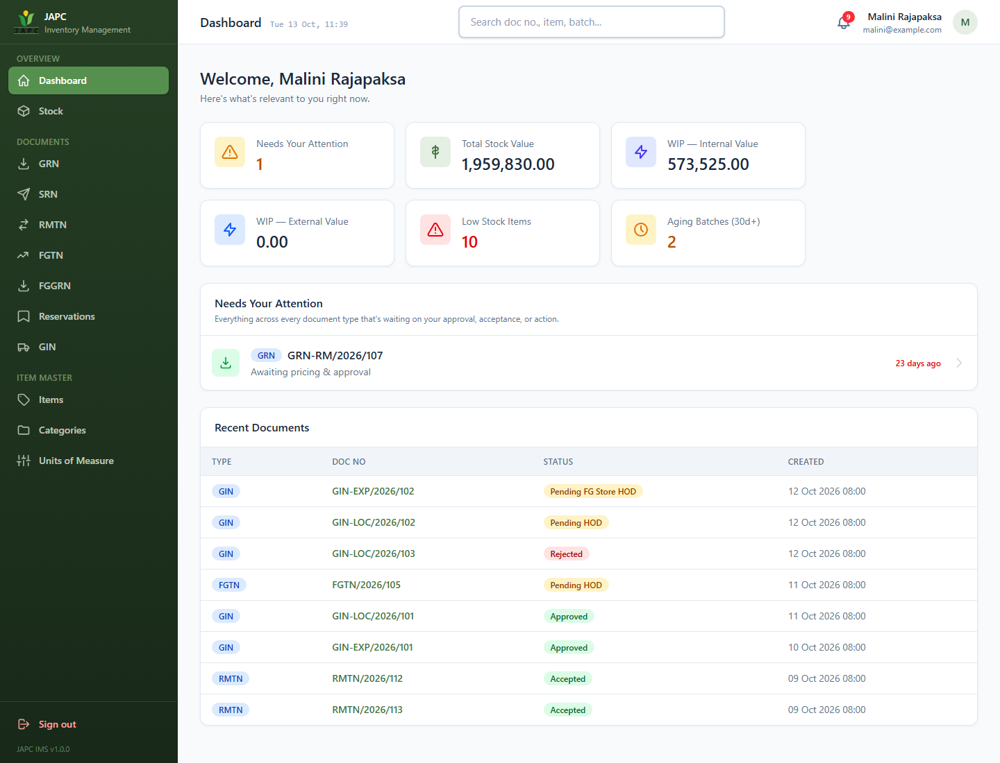 <b>Role-aware dashboard.</b> Each user sees only what their role and department can act on.</td>
    <td width="50%">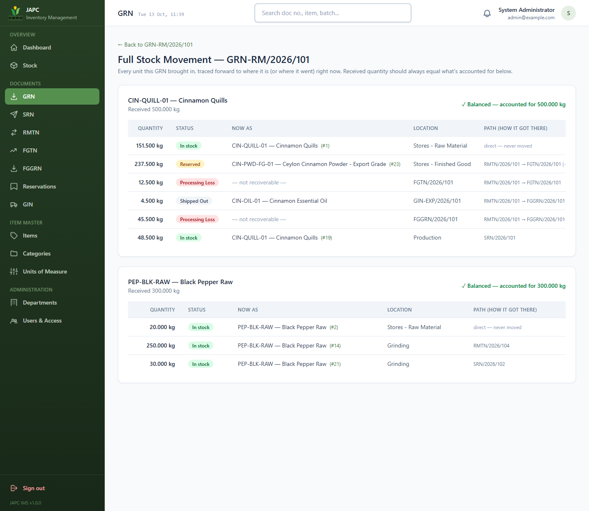 <b>Full stock movement.</b> Every kilo of a GRN traced to where it is, where it went, or where it was lost.</td>
  </tr>
  <tr>
    <td>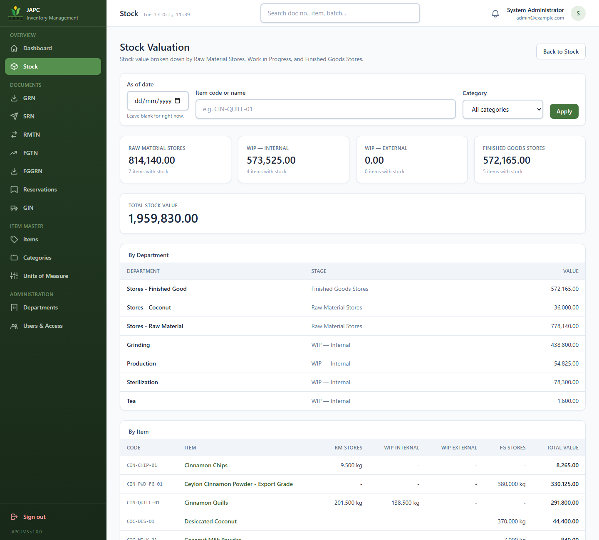 <b>Stock valuation</b> by Raw Material, WIP (internal and external) and Finished Goods, with an "as of date" mode.</td>
    <td>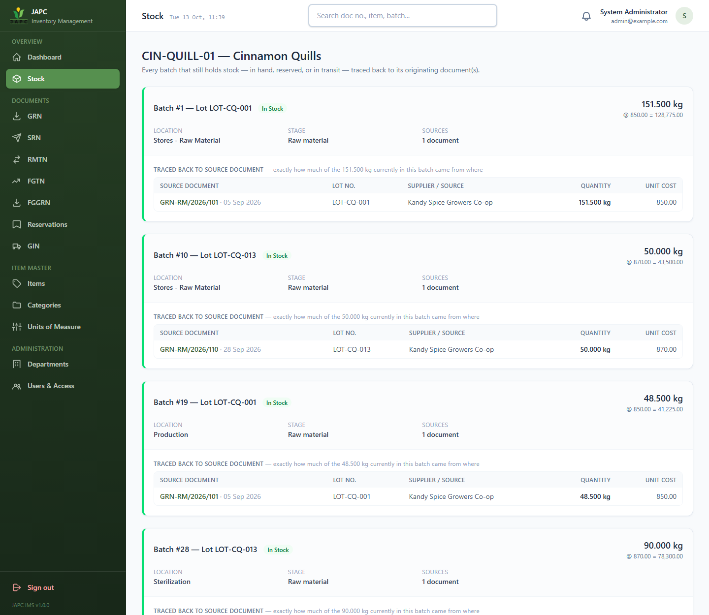 <b>Batch trace-back.</b> Exactly how much of each batch came from which source document.</td>
  </tr>
  <tr>
    <td>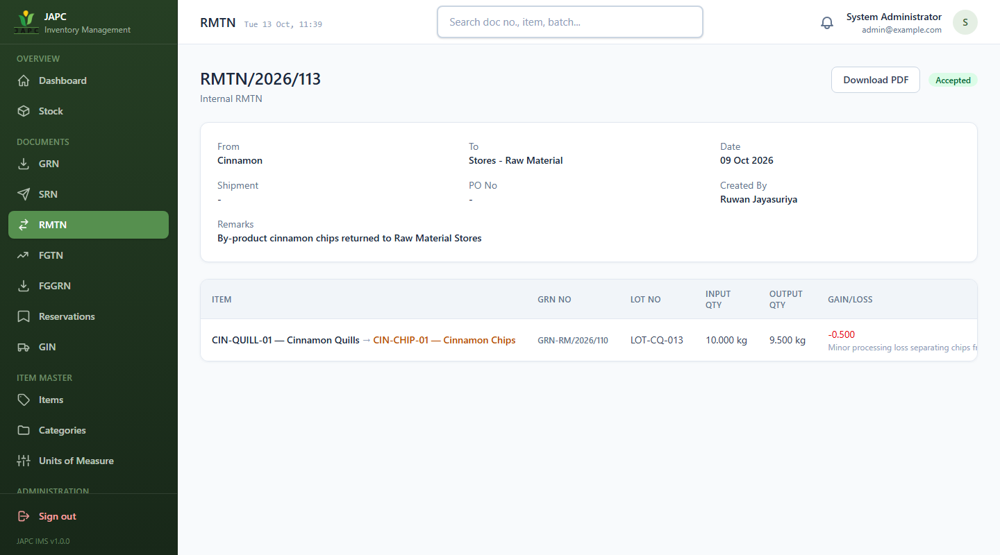 <b>Production conversion</b> recorded on a transfer note, with the loss and its reason.</td>
    <td>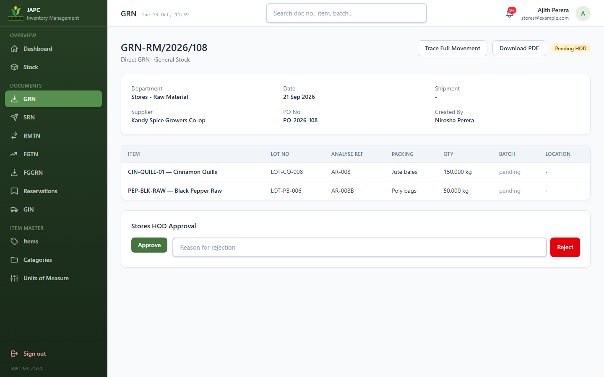 <b>Approval workflow.</b> The HOD approves or rejects with a recorded reason.</td>
  </tr>
  <tr>
    <td>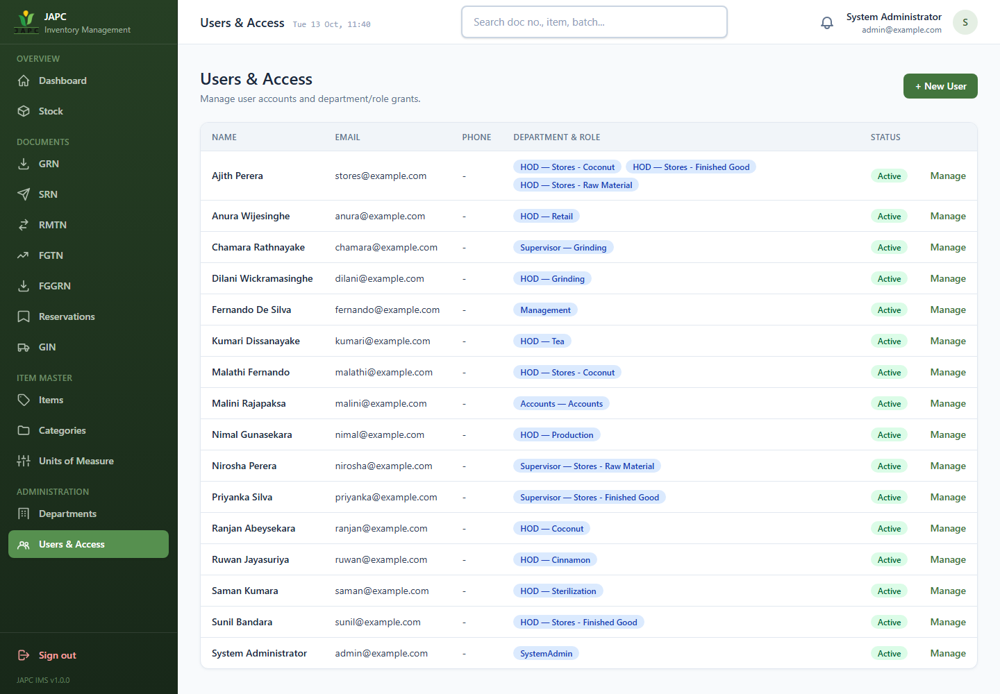 <b>Department-level access.</b> A user can hold different roles in different departments.</td>
    <td>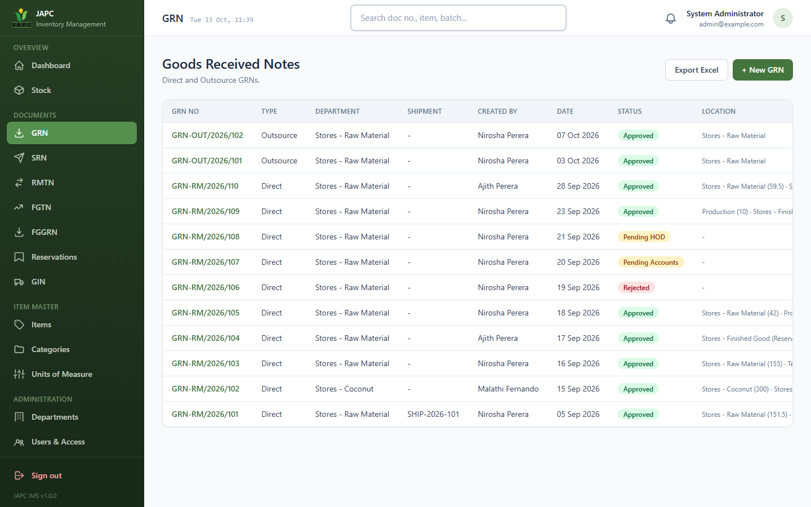 <b>Document lists</b> show the source GRN and where the stock is now.</td>
  </tr>
  <tr>
    <td>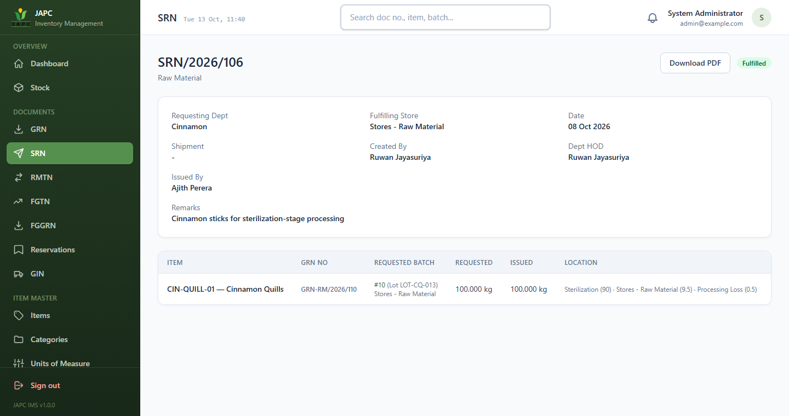 <b>Store requisition</b> bound to a specific batch, with gain/loss on issue.</td>
    <td>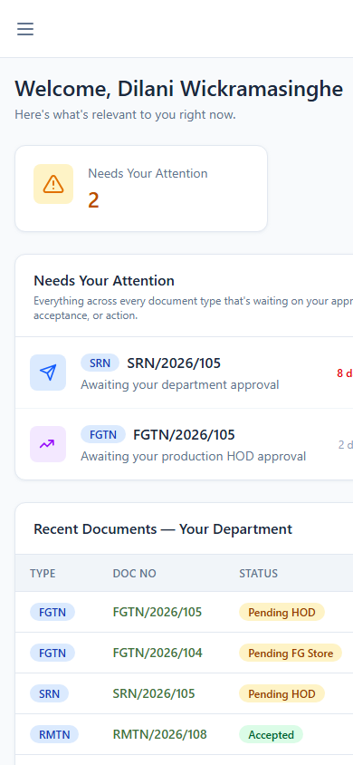 <b>Mobile-friendly</b>, because approvers work from their phones.</td>
  </tr>
</table>

More screens

<table>
  <tr>
    <td width="50%">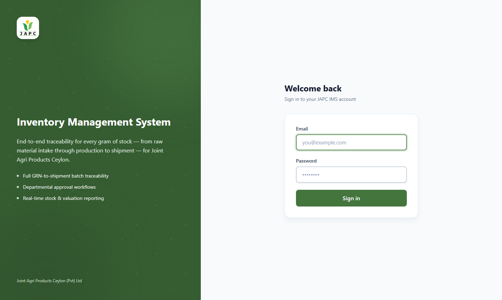 Sign-in page.</td>
    <td width="50%">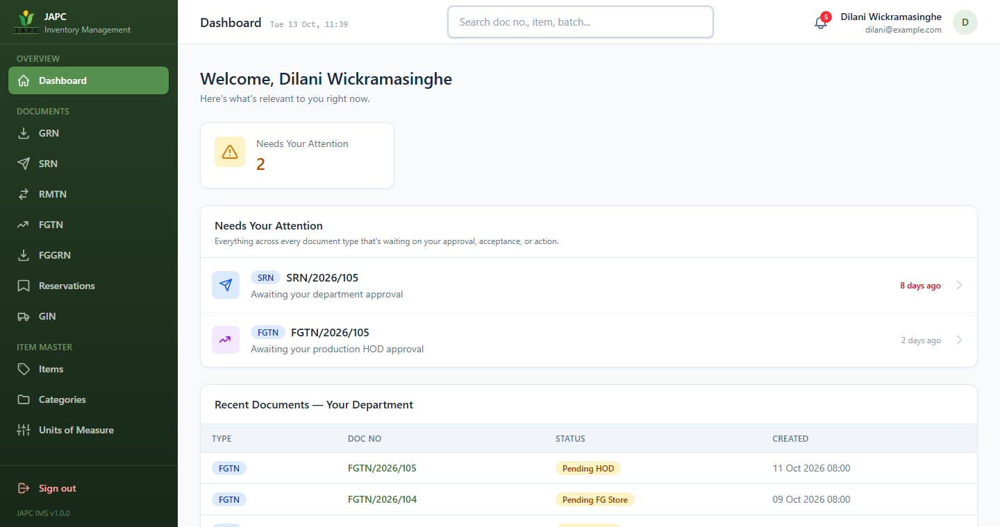 A department head's dashboard: pending approvals, oldest first, flagged when overdue.</td>
  </tr>
  <tr>
    <td colspan="2">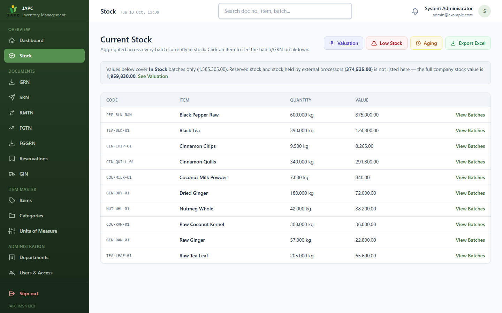 Stock overview with quantities and values per item.</td>
  </tr>
</table>

## How stock moves

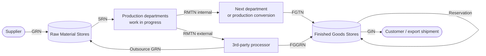

Every arrow is a document with its own approval workflow. Every document that moves stock
creates, splits or consumes **batches**, and each batch records its parents.

## Engineering problems worth reading about

**1. Batch genealogy as a graph, not a running total.**
Stock is never one number. It is the sum of individual batches, each linked to its parent batches
with the quantity each parent contributed. A batch milled from two GRNs is a weighted blend, and
the system can say "of these 400 kg, 300 kg came from GRN A and 100 kg from GRN B", all the way back
through splits and conversions.

**2. A forward trace that reconciles to the gram.**
The business rule was simple: if 500 kg comes in, 500 kg must be accounted for. The trace walks the
genealogy forward and every kilo ends in exactly one place. My first versions double-counted blends,
then silently dropped processing loss. The fix was to treat **loss as a first-class outcome** instead
of an unexplained gap:

| Where the 500 kg went | kg |
|---|---:|
| Still in raw material stores | 151.5 |
| In production | 48.5 |
| Finished powder (reserved for an order) | 237.5 |
| Shipped as essential oil | 4.5 |
| Processing loss (milling and distillation) | 58.0 |
| **Total** | **500.0** |

**3. Approval workflows per document type.**
Each of the six document types is its own state machine with its own rules (who approves, who may
create without approval, what a rejection needs). Rules live in service classes, not in views.

**4. Authorization reused as a feature.**
The "Needs your attention" feed runs the same permission checks the approve buttons use, so a user
is never shown a task they cannot act on, and the two can never drift apart.

**5. Valuation by stage, including stock held by outside processors.**
Stock value is bucketed by where it sits, not by a stored label. Material sent to a 3rd-party
processor is still the company's stock, so it is reported as *WIP: External*, separate from WIP on
the factory floor. Past dates are rebuilt by replaying an append-only stock ledger.

**6. Security basics done properly.**
Prepared statements everywhere, output escaping, CSRF tokens, password hashing with login lockout,
permissions enforced on the server (not just hidden buttons) and again in exports, documents are
never hard-deleted, and key actions are written to an audit log.

**7. Real deployment, not just localhost.**
Deployed to a VPS from git with a read-only deploy key. The web root is the `public/` folder only,
so config, SQL files and source are unreachable by URL (verified with automated probes after each
deploy). A deploy script handles updates, a health check, and rollback.

## What I learned

- Modelling a real business process: the hard part is the rules, not the screens.
- Traceability is a data-model decision. It cannot be added later with reports.
- Test with real roles, not only as an admin, because permission bugs hide from admins.
- Treat every "this number does not add up" as a bug to find, not a rounding error.

## Tech stack

PHP 8 (no framework, PSR-4 autoloading) · MySQL/MariaDB (InnoDB, transactions) · Tailwind CSS v4 (standalone CLI) ·
Alpine.js · Dompdf · PhpSpreadsheet · Git · Linux (AlmaLinux) · OpenLiteSpeed · Cloudflare

---

*Built by Heshan. The code is private. Contact me through my GitHub profile for a walkthrough.*
