# Inventory Management System with Batch Traceability and Valuation

A full-stack inventory system I built in plain PHP and MySQL as the in-house developer at
**Joint Agri Products Ceylon (Pvt) Ltd**, an agri-products exporter.
It replaces a paper-based process spread across about eleven sections (stores, production,
accounts and others) and answers two questions the paper process could not:
**"This 500 kg came in on one GRN. Where did every kilo go?"** and
**"What is all of our stock worth, today, and why?"**

> **Portfolio showcase.** This repository contains screenshots and a write-up only. The source
> code is private because the system runs the company's live operations. All data shown is
> fictional demo data (no real staff, stock or contact details). A live walkthrough is
> available on request.

## At a glance

| | |
|---|---|
| **Type** | Web application (live in production) |
| **Scope** | 7 document types, 5 roles, 31 database tables, 126 routes, 11 departments |
| **Stack** | PHP 8 (no framework, ~16,000 lines), MySQL/MariaDB, Tailwind CSS v4, Alpine.js, Composer |
| **Hosting** | VPS (AlmaLinux, CyberPanel/OpenLiteSpeed, Cloudflare), deployed with git |
| **Delivered with** | User manual, administrator guide, technical and deployment guides, valuation method, role-by-role UAT packs and a recorded walkthrough (kept private) |

## What it does

- **Document workflows** for goods received (GRN), store requisitions (SRN), internal and external
  transfers (RMTN), finished-goods transfers (FGTN), finished-goods receipts (FGGRN), shipment
  reservations and goods issue (GIN), each with its own approval steps.
- **Batch traceability:** every batch records its parents, so any stock can be traced back to the
  GRN(s) it came from, and any GRN forward to where every kilo is now, through blends, splits and
  production conversions (even kilograms of bark into litres of oil).
- **Valuation module** by Raw Material, WIP (internal and external) and Finished Goods, by
  warehouse and by item, with an "as of date" mode and automatic data checks that prove the figures.
- **Reports** for management: period movement with a proof line, stock aging in six buckets, and
  outturn (yield). Each exports to a styled PDF and to Excel.
- **Ship confirmation:** export goods stay on the books until Accounts confirm the bill of lading.
- **Warehouses** inside the Stores departments, with recorded stock moves.
- **Role-based access** (Supervisor, HOD, Accounts, Management, System Admin) granted per department.
- Per-user dashboards, in-app and email notifications, low-stock and aging alerts, global search,
  and clean PDF and Excel output for every document.

## Screenshots

<table>
  <tr>
    <td width="50%"> <b>Stock valuation</b> by stage, with the reservation value shown inside Finished Goods, never added twice, and the data checks passing.</td>
    <td width="50%"> <b>Full stock movement.</b> Every kilo of a GRN traced to where it is, where it went, or where it was lost. The page proves it is balanced.</td>
  </tr>
  <tr>
    <td>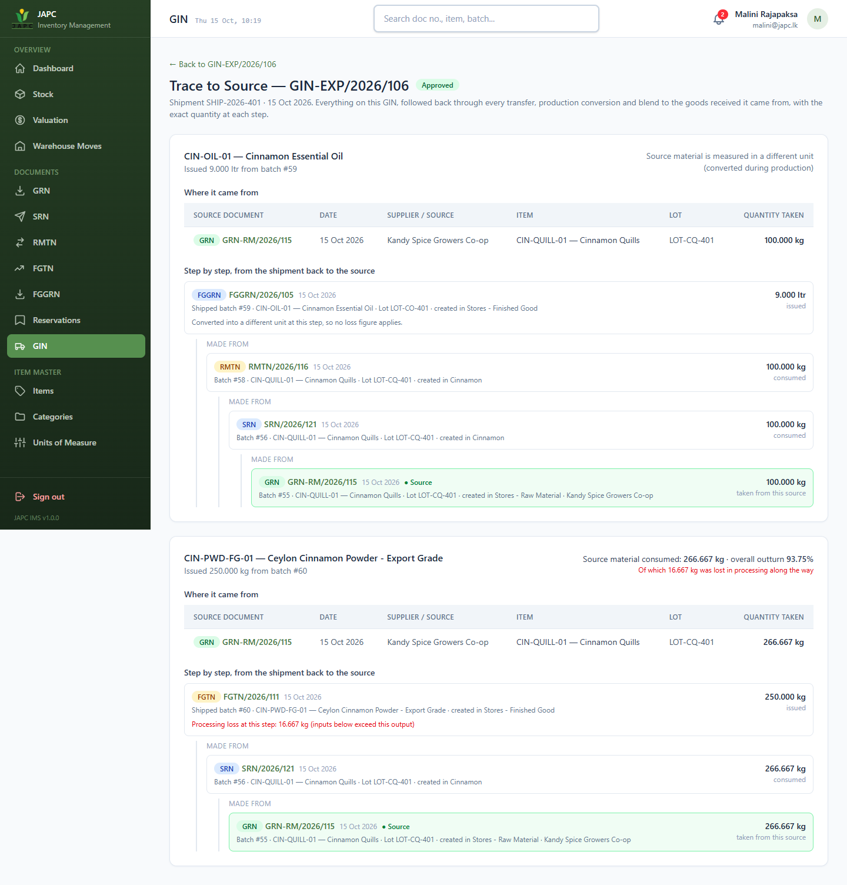 <b>Trace to source.</b> A shipment followed back through production and the outside processor to the supplier's GRN.</td>
    <td>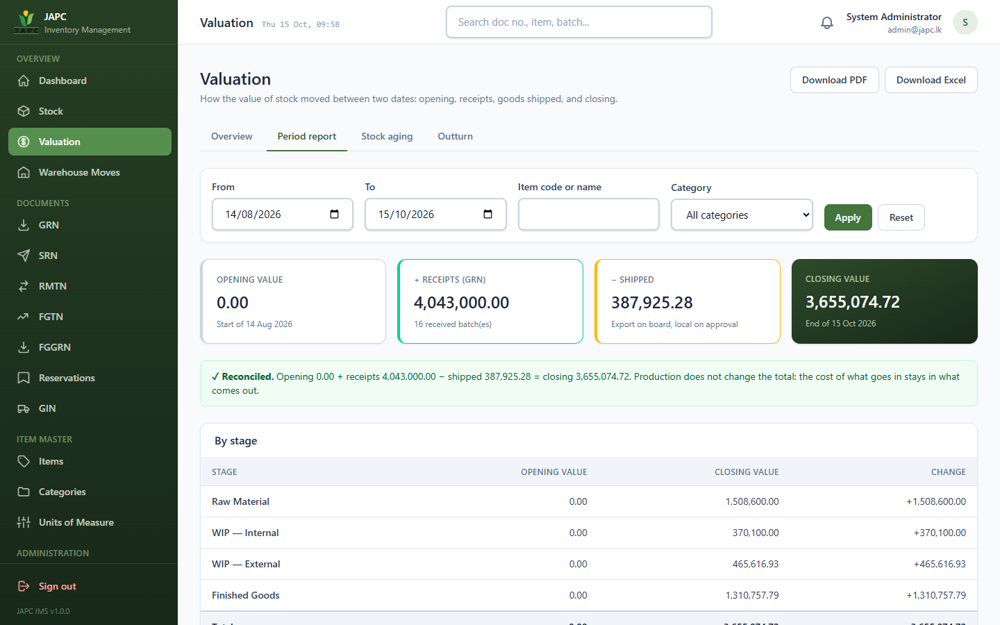 <b>Period report.</b> Opening + receipts − shipped = closing, shown as a reconciled proof.</td>
  </tr>
  <tr>
    <td>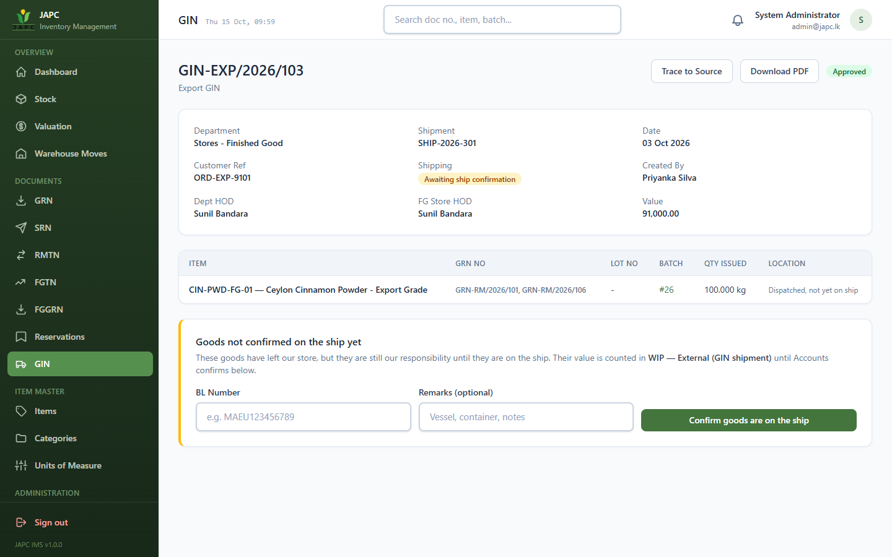 <b>Export shipment awaiting the ship.</b> Stock has left the store, but stays on the books until the bill of lading is entered.</td>
    <td>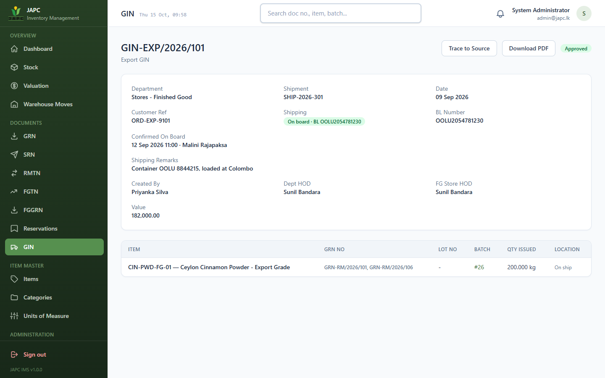 <b>Confirmed on board</b> with the BL number, date and who confirmed.</td>
  </tr>
  <tr>
    <td> <b>Production conversion</b> recorded on a transfer note, with the loss and its reason.</td>
    <td> <b>Approval workflow.</b> The HOD approves or rejects with a recorded reason.</td>
  </tr>
  <tr>
    <td>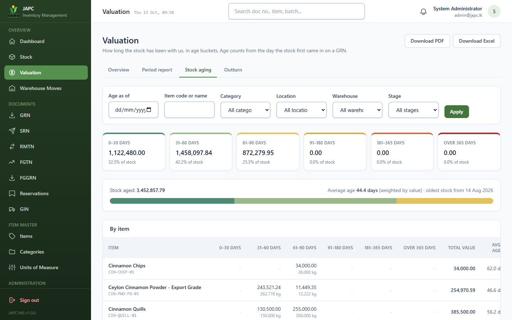 <b>Stock aging</b> in six buckets, counted from the original GRN date.</td>
    <td>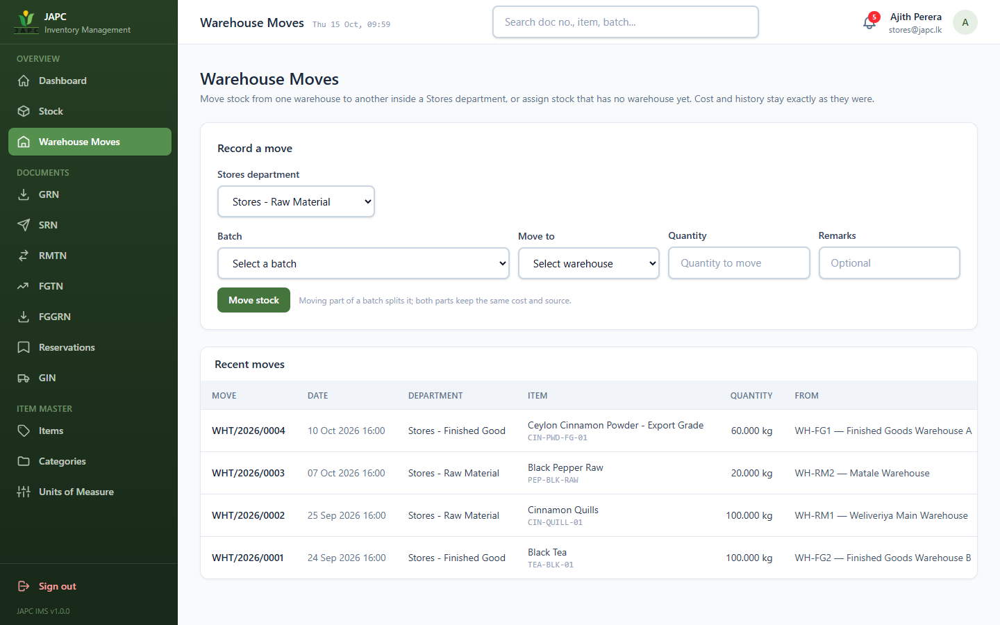 <b>Warehouse moves</b> recorded by the Stores HOD, each as its own document.</td>
  </tr>
  <tr>
    <td>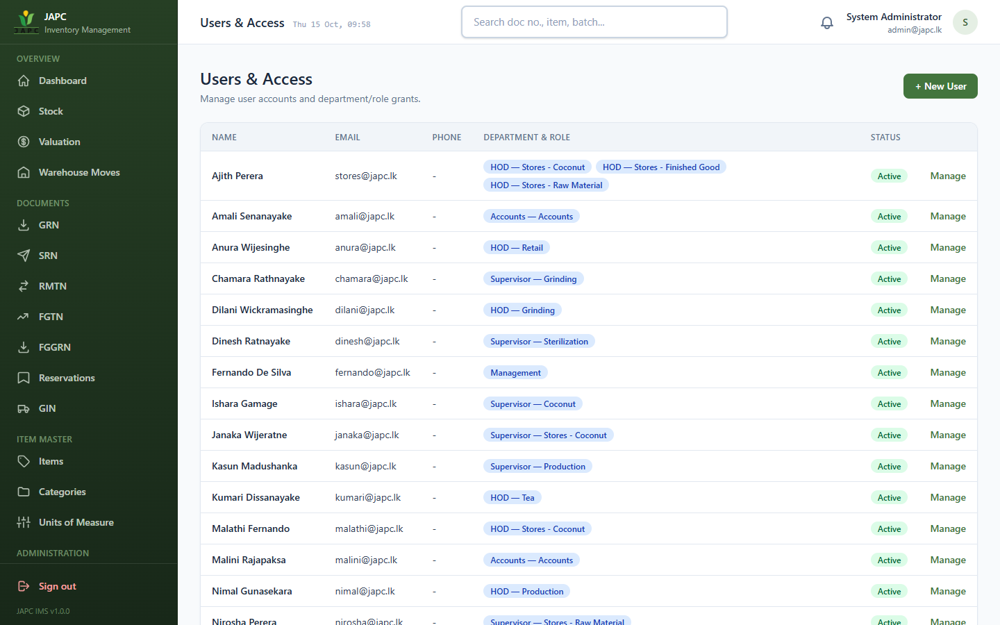 <b>Department-level access.</b> A user can hold different roles in different departments.</td>
    <td>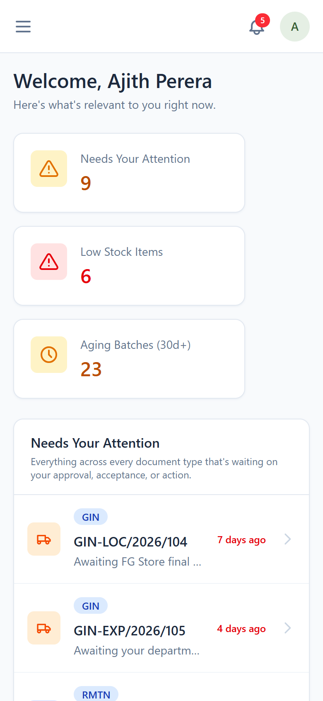 <b>Mobile-friendly</b>, because approvers work from their phones.</td>
  </tr>
</table>

More screens

<table>
  <tr>
    <td width="50%"> Sign-in page.</td>
    <td width="50%"> Accounts dashboard: GRNs awaiting pricing and shipments awaiting confirmation.</td>
  </tr>
  <tr>
    <td> A department head's dashboard: pending approvals, oldest first.</td>
    <td> Stock overview with quantities and values per item.</td>
  </tr>
  <tr>
    <td> Every batch of one item, with its source documents.</td>
    <td> Document lists show the source GRN and where the stock is now.</td>
  </tr>
  <tr>
    <td>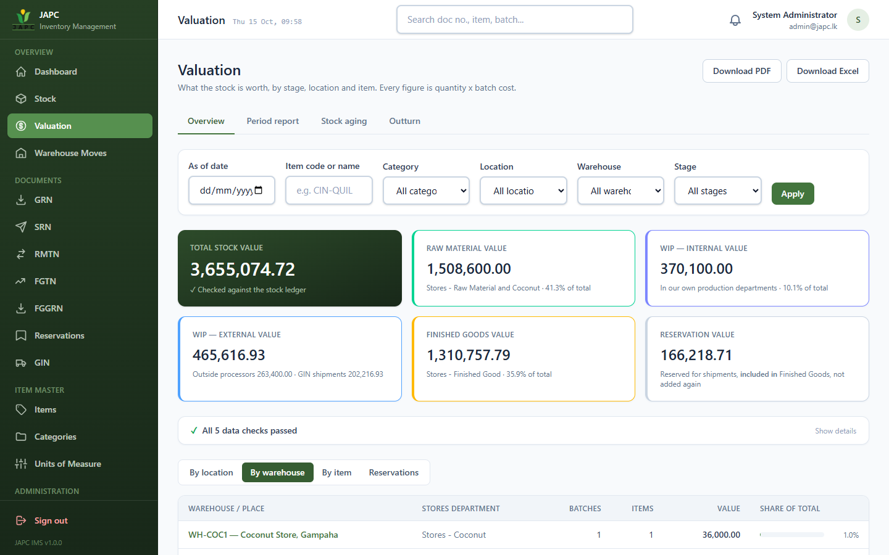 Valuation by warehouse.</td>
    <td>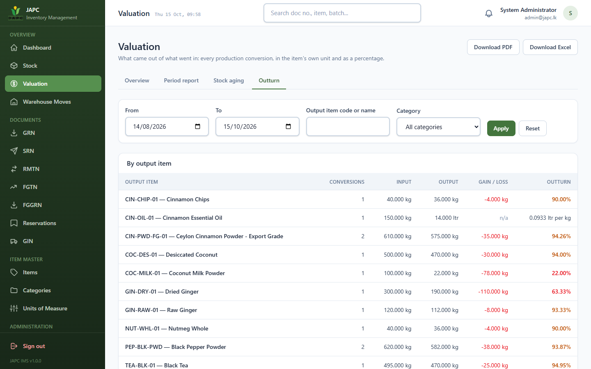 Outturn: how much finished product each raw material kilo yields.</td>
  </tr>
  <tr>
    <td>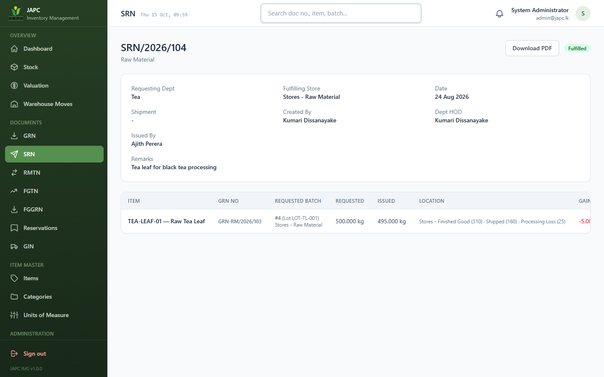 A store requisition bound to a specific batch, with gain/loss on issue.</td>
    <td>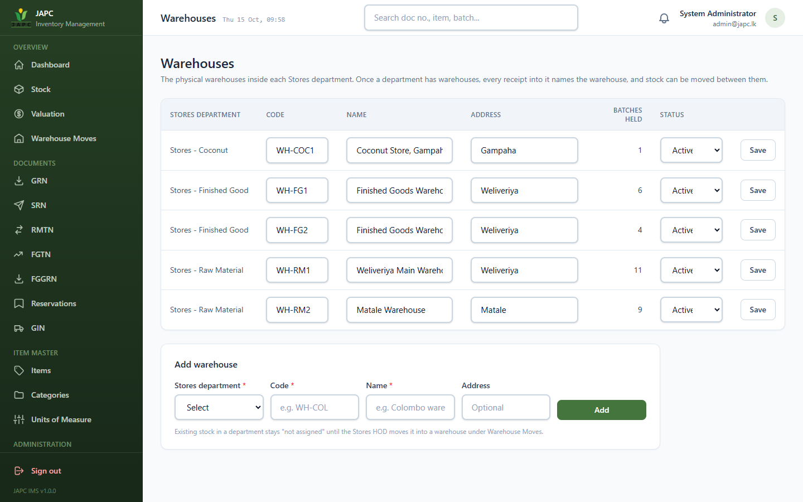 Warehouse set-up inside Stores departments.</td>
  </tr>
  <tr>
    <td colspan="2">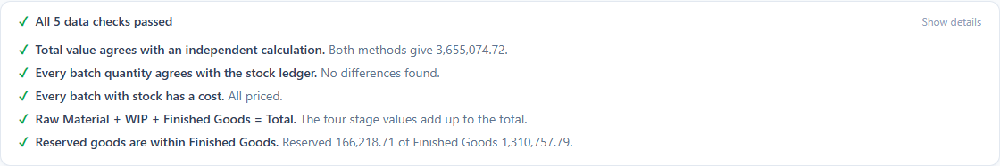 The five data checks that run every time the valuation page opens.</td>
  </tr>
</table>

## How it works

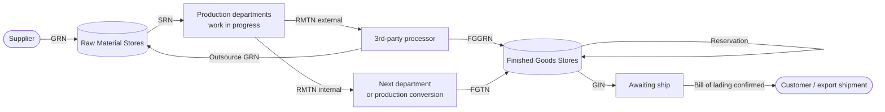

Every arrow is a document with its own approval workflow. Every document that moves stock
creates, splits or consumes **batches**, and each batch records its parents.

## Engineering highlights

**1. Batch genealogy as a graph, not a running total.**
Stock is never one number. It is the sum of individual batches, each linked to its parent batches
with the quantity each parent contributed. A batch milled from two GRNs is a weighted blend, and
the system can say "of these 400 kg, 300 kg came from GRN A and 100 kg from GRN B", all the way back
through splits and conversions.

**2. A forward trace that reconciles to the gram.**
The business rule was simple: if 500 kg comes in, 500 kg must be accounted for. The trace walks the
genealogy forward and every kilo ends in exactly one place. My first versions double-counted blends,
then silently dropped processing loss, then reported a bogus "91 kg lost" when kilograms of bark
became litres of oil. The fixes: treat **loss as a first-class outcome**, and when the unit changes,
convert the outcome back to the parent's unit while still showing the amount in the unit it was made.

| Where the 500 kg went | kg |
|---|---:|
| Still in raw material stores | 50 |
| In a sterilization trial | 30 |
| Sent for distillation, returned and shipped as 9 litres of oil | 100 |
| Finished powder in stock | 50 |
| Finished powder shipped | 250 |
| Processing loss (milling) | 20 |
| **Total** | **500** |

**3. Costing that conserves value.**
When a lot is processed, the cost of everything consumed stays in what it becomes: unit cost =
Σ(parent cost × quantity) ÷ output quantity. A loss makes the output dearer per unit instead of making
value vanish, and a change of unit (kilograms into litres) gets a true cost per litre. The valuation
therefore reconciles exactly, and the shipped value is easy to check by hand.

**4. Valuation that proves itself.**
Stock value is bucketed by where it sits: Raw Material, WIP internal, WIP external and Finished Goods.
Material at a 3rd-party processor is still the company's stock, so it is *WIP External*, and so is an
export shipment that has been issued but not yet confirmed on the ship. Reservation value is shown as
"of which" Finished Goods and is never added twice. Five automatic checks recompute the total from the
ledger every time the page opens, and the period report shows opening + receipts − shipped = closing.

**5. Approval workflows per document type.**
Each document type is its own state machine with its own rules (who approves, who may create without
approval, what a rejection needs). Rules live in service classes, not in views.

**6. Authorization reused as a feature.**
The "Needs your attention" feed runs the same permission checks the approve buttons use, so a user
is never shown a task they cannot act on, and the two can never drift apart.

**7. Security basics done properly.**
Prepared statements everywhere, output escaping, CSRF tokens, password hashing, permissions enforced on
the server (not just hidden buttons) and again in exports, documents are never hard-deleted, and key
actions are written to an audit log.

**8. Real deployment, not just localhost.**
Deployed to a VPS from git with a read-only deploy key. The web root is the `public/` folder only,
so config, SQL files and source are unreachable by URL (verified with automated probes after each
deploy). Database changes ship as ordered migrations with a release checklist, and email is sent
after the response so a slow mail server never slows a user down.

**9. Tested the way it is used.**
Every role was walked through its own screens (an administrator bypasses most access rules, so admin-only
testing hides permission bugs). A scripted, recorded run follows one export order from goods received to
the ship across nine people, and the data checks must stay green.

## My role

I designed and built the whole system end to end as the in-house developer: requirement gathering,
database design, the batch-traceability engine, costing and valuation, approval workflows, role
permissions, the web interface, reports and exports, documentation, user acceptance testing material,
and deployment to the company's VPS.

## What I learned

- Modelling a real business process: the hard part is the rules, not the screens.
- Traceability is a data-model decision. It cannot be added later with reports.
- Costing rules decide whether a valuation can ever reconcile. Decide them first.
- Test with real roles, not only as an admin, because permission bugs hide from admins.
- Treat every "this number does not add up" as a bug to find, not a rounding error.

## Tech stack

PHP 8 (no framework, PSR-4 autoloading) · MySQL/MariaDB (InnoDB, transactions) · Tailwind CSS v4 (standalone CLI) ·
Alpine.js · Dompdf · PhpSpreadsheet · PHPMailer · Git · Linux (AlmaLinux) · OpenLiteSpeed · Cloudflare

## Built with AI assistance

I developed this project myself. When I ran into problems along the way (requirement gathering,
planning, testing, debugging or deployment), I used **[Claude](https://www.anthropic.com/claude)**
(by Anthropic) as an AI assistant to help me work through them.

---

*Built by Heshan. The source code is private. Contact me through my GitHub profile for a walkthrough.*
